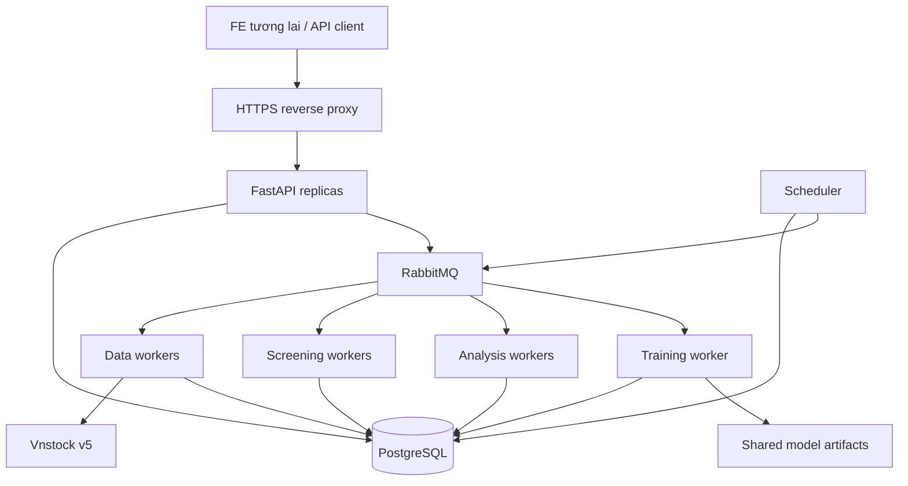

# 03 — Kiến trúc, dữ liệu và concurrency

## Process topology



PROPOSED: modular monolith, không tạo microservices cho từng engine. API nhẹ, workers có thread/CPU/RAM budget rõ. PostgreSQL là persistence nghiệp vụ, queue là delivery transport. Model artifact có checksum và metadata trong DB, lưu shared object storage hoặc shared volume beta có backup; không chỉ ở disk worker.

## Module boundaries

`identity`, `billing`, `usage`, `jobs`, `market_data`, `screening`, `analysis`, `quant`, `models`, `administration`, `infrastructure`.

Quant không đọc files/provider/DB và không biết tài khoản. Analysis orchestrator resolve inputs và gọi engines. Billing cấp entitlement; worker không tự suy ra quyền từ giá gói đang thay đổi. Shared infrastructure không chứa business rules.

## Dữ liệu chính

| Nhóm | Entities |
|---|---|
| Identity | users, admin_accounts, refresh_sessions, roles |
| Billing | plan_versions, orders, payment_events, payments, subscriptions, entitlement_versions, adjustments |
| Usage | reservations, usage_ledger |
| Jobs | jobs, job_attempts, outbox, inbox, dependency_requests |
| Market | instruments, exchange/sector references, daily_bar_revisions, provisional_observations, data_manifests |
| Screening | screening_runs, screening_results, published_screening |
| Quant | component_results, model_versions, market_snapshots, snapshot_members, analysis_reports |
| Administration | config_versions, audit_events |

Owned entities có account_id và ownership constraints; shared market/reference entities không nhân bản theo khách. Published bars/models/reports bất biến; correction tạo revision. Numeric prices VND, index points, _pct khác _ratio. Index theo account/date, job status/ready time, symbol/session/revision và component key; partitioning chỉ sau đo tải.

## Admission và delivery

Trong một transaction: kiểm tra entitlement/active job limits → reserve quota → insert job → insert outbox. Unique account + idempotency key; cùng key khác payload bị conflict. Dispatcher publish có confirm; inbox và DB state bảo vệ duplicate delivery. Không hứa exactly-once delivery; effect phải idempotent.

States: QUEUED, WAITING_DATA, RUNNING, RETRY_WAIT, SUCCEEDED, FAILED, CANCELLED. Retry có exponential backoff/jitter, max attempts và reason classes. Không tự retry invalid inputs/tier denial vô hạn.

Worker claim lease và execution token; heartbeat renew. Completion check token/lease/cancel trong DB transaction; stale process không được ghi success. Report insert, job completion, quota settlement và notification intent commit nguyên tử. Broker ack sau commit. Reconciler recover expired leases/outbox/dependencies.

### Lifecycle và terminal settlement đề xuất

`QUEUED → WAITING_DATA → QUEUED → RUNNING`; nếu dependencies đã ready thì đi thẳng `QUEUED → RUNNING`. Lỗi tạm thời chuyển sang `RETRY_WAIT → QUEUED`; hết retry hoặc quá deadline thành `FAILED`. Các state chưa terminal có thể chuyển `CANCELLED`. SUCCEEDED/FAILED/CANCELLED là terminal, không được nhận completion/retry làm sống lại job.

Job lưu entitlement/quota bucket và quota-policy version tại admission, target session, dependency deadline và `compute_started_at`. Khi resolve đủ inputs, transaction pin data manifest/snapshot/model/config một lần trước compute; retry dùng đúng versions đó. Không âm thầm đổi sang phiên hoặc model mới sau khi job đã pin. Trước khi pin, job giữ target session cố định và chờ revision ready theo policy. Lỗi schema/input có thể phát hiện sớm phải bị từ chối trước reservation.

`compute_started_at` được ghi bằng conditional update ngay trước customer analysis compute, không phải lúc worker chỉ claim message hoặc đang chờ ingestion/snapshot. Cờ này không reset qua retries. Shared background ingestion/training/snapshot không làm mọi waiter bị coi là đã compute. Quy tắc thu lượt dựa trên cờ này nằm tại [mục 05](05-api-auth-billing.md).

Cancel và completion khóa cùng job row, kiểm tra state/token, rồi commit terminal state + quota settlement + giải phóng account active-job slot trong một transaction. Nếu completion thắng trước, cancel trả trạng thái đã hoàn tất; nếu cancel thắng, execution token bị fence và completion muộn bị từ chối. Cancel lặp trả cùng kết quả, không thêm ledger effect. Worker dừng cooperative khi có thể; global CPU/RAM/concurrency slot chỉ được thu hồi khi attempt thực sự dừng, dù account slot đã được giải phóng.

Reconciler không release quota chỉ vì lease hết hạn: trước hết retry/recover attempt nếu còn budget/deadline. Job còn chờ giữ reservation; job đã terminal phải có settlement duy nhất. Reconciler sửa terminal job thiếu settlement bằng transaction idempotent, cảnh báo reservation/active slot bị treo và không release một job còn compute hợp lệ.

## Shared components

Canonical key: component/engine version + history manifest + index/sector/reference versions liên quan + feature/config subset + unit/adjustment + horizon/seed nếu dùng. Distributed claim qua DB unique key/lease. Cùng symbol không đồng nghĩa cùng key. Tenant sizing và clock-dependent freshness không reuse stock-only results.

Cross-sectional components bổ sung `market_snapshot_id` vào dependency key. Snapshot có builder lease/fencing, member records và con trỏ published riêng; chỉ publish sau validation, không lấy tập jobs hiện đang chờ làm universe. Snapshot contract và policy thiếu reference tại [mục 04](04-pipelines-and-reports.md).

## Scaling

Start một VPS nếu benchmark đạt; API stateless, workers thêm replicas/machines. Tách analysis compute trước, rồi DB/broker theo tải. Scheduler slot unique trong DB chống chạy trùng. Provider limiter tập trung ở ingestion gateway/DB coordination; thêm workers không tăng quota thực tế. Giới hạn prefetch và numerical library threads tránh oversubscription.

Single-VPS beta có single point of failure; scalability không đồng nghĩa HA. Chưa xác định worker count/hardware trước benchmark.

## Repository đề xuất

```text
backend/
  src/service/{identity,billing,usage,jobs,market_data,screening,analysis,quant,models,administration,infrastructure}/
  migrations/
  tests/
deploy/
load-tests/
docs/
```

Chỉ tạo module khi có implementation. Prototype gốc giữ read-only để đối chiếu, không đưa exporter/news vào runtime image.
